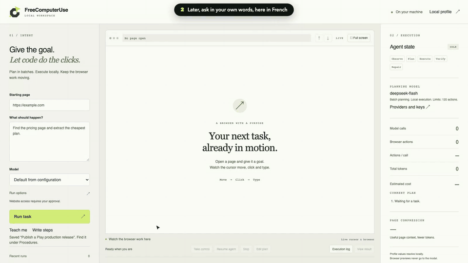

# FreeComputerUse


<p align="center">
  <a href="https://www.npmjs.com/package/free-computer-use"></a>
  <a href="https://github.com/OthmaneBlial/FreeComputerUse/releases/latest"></a>
  <a href="LICENSE"></a>
  
</p>

<p align="center">
  <a href="#watch-it-work">Watch it work</a> ·
  <a href="#quick-start">Quick start</a> ·
  <a href="#teach-it-once-replay-it">Teach &amp; replay</a> ·
  <a href="#choose-a-model">Choose a model</a> ·
  <a href="https://othmaneblial.github.io/FreeComputerUse/">Project site</a>
</p>

**Teach it once. Replay it without the model.** FreeComputerUse is an open-source browser agent that runs Playwright on your machine. Give it a goal with the model you choose, or show it a task once. It saves the steps as a procedure, replays them locally with zero model calls, asks the model only to repair what changed, and stops for your approval before anything is submitted.

> [!NOTE]
> Procedures, teach mode and smart replay are on `main` and not yet in the npm release `0.2.23`. [Run from source](#from-source-with-procedures) to use them.

## Watch it work

[](https://othmaneblial.github.io/FreeComputerUse/lab/media/procedure-demo.mp4)

One uncut dashboard session, in real time. The steps of a Google Play release are written once, with English and French labels. A request in French finds them, fills in the app, version and bundle, asks only for the release notes, and replays everything on the local Play Console simulator (not Google software): 11 browser actions, **0 model calls**, and 3 approvals you give (the site, Save and publish, Send changes for review). The run counts only because the simulator holds the new version in review. [Full video](https://othmaneblial.github.io/FreeComputerUse/lab/media/procedure-demo.mp4) · [How it was recorded](scripts/capture-procedure-video.ts).

[](https://othmaneblial.github.io/FreeComputerUse/lab/media/incident-demo.mp4)

An open-ended task planned by a model: DeepSeek Flash investigates a synthetic API incident across six pages, then fills in and downloads a brief, with 19 browser actions, 9 model calls and 28,680 tokens. Nothing is rolled back and no one is contacted. One recorded run, not a success rate. [Watch it](https://othmaneblial.github.io/FreeComputerUse/lab/media/incident-demo.mp4) · [Its evidence](assets/readme/incident-evidence.json).

## Quick start

Requires Node.js 22.13+, npm and an installed browser. These commands use system Chrome and do not download a separate browser.

### From source, with procedures

```bash
git clone https://github.com/OthmaneBlial/FreeComputerUse.git
cd FreeComputerUse
npm ci
cp .env.example .env
chmod 600 .env
```

Set `FCU_BROWSER_CHANNEL=chrome` in `.env`, and a provider if you want model-planned tasks (see [`.env.example`](.env.example)). Then:

```bash
npm run agent -- doctor
npm run dev
```

Open **http://127.0.0.1:4318**. To try procedures without a model, follow the [Google Play walkthrough](docs/GOOGLE_PLAY.md) on the local simulator.

### npm release, without procedures

```bash
npm install --global free-computer-use@0.2.23
FCU_BROWSER_CHANNEL=chrome agent doctor
FCU_BROWSER_CHANNEL=chrome agent ui
```

## Teach it once, replay it

There are four ways to make a procedure:

1. **Show it:** press **Teach me** and do the task in the live browser.
2. **Write it:** list the steps in plain English or French, with `|` between alternatives.
3. **Keep a run:** save a task the model completed.
4. **Show one step when stuck:** a failing step pauses the run, you do it, and your action is saved.

A later request in other words or another language finds the procedure:

```text
Publie la version 1.5 de l'app "Snake Arena" avec ./build/snake-1.5.aab
```

It reads `app`, `version` and `bundle` from the request, asks for the release notes, and replays the steps locally. Saved alternative targets are tried first. If a button was renamed, the model repairs that step only and the fix is saved as a new version. If most steps stop matching, for example on another language, it plans the rest from the page in one request, and the procedure's success check must still pass. Publishing, paying, deleting and similar steps ask for your approval on every run; a recorded demonstration is never a standing approval.

- [Teach a procedure](docs/TEACH.md): record, write or keep, then manage, version, export and import.
- [Google Play releases](docs/GOOGLE_PLAY.md): the full walkthrough, several developer accounts, blocking errors, and what was checked on the real console.

## Measured: pay for the first run, replays are free

The same Play release nine times on the local simulator: explore, replay with new values, replay after a UI change, switch to French and back. A run counts only if the simulator holds the new version in review.

| Model, 25 October 2026 | Runs correct | First run | UI change | First French run | Other six replays |
| --- | :---: | ---: | ---: | ---: | ---: |
| DeepSeek Flash API, 3 trials | 27 of 27 | 8–9 calls, 17–20k tokens | 3–4 calls | 6–8 calls | 0 calls |
| Claude Code, `claude-opus-5-5` | 9 of 9 | 9 calls | 4 calls | 7 calls | 0 calls |
| Codex CLI, `gpt-6.1-sol` | 9 of 9 | 12 calls | 3 calls | 9 calls | 0 calls |

A DeepSeek trial of nine runs cost $0.0052 to $0.0057. After the first French run, the procedure keeps both labels and both success texts, so it switches languages with no model call. This is one task on one simulator, a small sample. See the [method, raw results and limits](docs/BENCHMARKS.md#procedures-and-token-savings).

## Try it without a model key

Enter one of these goals in the dashboard:

| Goal | What you get |
| --- | --- |
| `Read the page` | Visible page text |
| `Extract the links` | Link labels and URLs |
| `Extract the first 5 links` | A verified, bounded link list |
| `Extract the table` | Three rows from the [practice revenue table](https://othmaneblial.github.io/FreeComputerUse/lab/reports.html) |

These local strategies make zero model calls. They are narrow page-reading jobs; general browsing tasks need a configured model.

## How it works

1. Read the page structure and accessible controls.
2. Ask your selected provider for a small, typed batch of actions.
3. Run the actions locally with Playwright. Opening a new site asks for approval.
4. Check the result, repair bounded failures, and fall back to a screenshot only if you turned on the [vision fallback](docs/PROVIDERS.md#vision-fallback).

The model cannot run shell commands or arbitrary JavaScript. Browser profiles, execution, history and downloads stay on your machine. Your task and the selected page context go to the provider you choose.

## Choose a model

Use an API key or a signed-in provider CLI. API usage and consumer subscriptions have separate billing and limits.

| Route | Setup | Live evidence |
| --- | --- | --- |
| Claude API | `agent providers set-key anthropic`, or `ANTHROPIC_API_KEY`; default model `claude-opus-5-5` | Contract tests only, no key yet |
| DeepSeek API | `agent providers set-key deepseek`, or `DEEPSEEK_API_KEY`; default model `deepseek-flash` | Procedure benchmark, 27 of 27 |
| OpenAI API | `agent providers set-key openai` and `OPENAI_MODEL` | Contract tests only, no key yet |
| xAI, Gemini, Mistral, OpenRouter | `LLM_PROVIDER=openai-compatible` with `LLM_BASE_URL`, `LLM_MODEL`, `LLM_API_KEY` | Contract tests only |
| Claude Pro/Max plan | Sign in with Claude Code 2.1.310+, then `LLM_PROVIDER=claude-subscription` | Procedure benchmark, 9 of 9 |
| ChatGPT plan | Sign in with Codex CLI, then `LLM_PROVIDER=codex-subscription` | Procedure benchmark, 9 of 9 |

`agent providers test <id>` sends one real request. The dashboard has the same test, a write-only key field and a per-task model menu. Keys go to the macOS Keychain or a private file. Some Codex calls wait several minutes; set `FCU_CLI_TIMEOUT_MS=300000` if they time out. Retries, fallback providers and escalation to a stronger model are described in the [provider guide](docs/PROVIDERS.md).

## Use with an MCP host

Run `agent mcp` to expose four bounded tools over local `stdio`: start, inspect, follow, and stop a browser task. `follow` returns completion checks. Site and sensitive-action approvals still need a human response in a host that supports form elicitation. No HTTP endpoint is opened. See [MCP setup and limits](docs/MCP.md).

## Privacy and security

- Browser execution, profiles, history, and downloads stay local. The selected task and page context go to your model provider. Screenshots are not sent unless you set `FCU_VISION=1`; then last-resort repairs include a viewport screenshot with form fields masked.
- It does not solve CAPTCHAs or 2-Step Verification. When a page looks like a sign-in or security challenge, it pauses so you can take control.
- Normal mode asks before moving to a new site and blocks connections to private and reserved addresses. Ultra mode is opt-in and skips those origin checks.
- Sensitive actions have a separate approval step on every run. Detection relies on heuristics and cannot identify every deceptive page.
- Procedure exports contain steps, parameter names and checks, never parameter values, file paths, run history or keys.
- Local data is not encrypted and does not expire automatically. See [data storage and deletion](docs/LOCAL_DATA.md) and the [security boundaries](SECURITY.md) before using personal data.

## Evidence and support

The full local gate covers TypeScript, the test suite, the build, a credential-pattern scan and the production dependency audit. On 25 October 2026 it passed with 221 of 221 tests on macOS 26.6, Node 25.9.0 and Chrome 155. Platform limits and dated provider evidence are in the [support matrix](docs/SUPPORT_MATRIX.md). Tests do not certify an untested provider, browser, operating system or real website.

The public task suite measured on 18 September passed 14 first runs and 14 compatible repeats in that single trial; the repeats made zero model calls. These synthetic and public-web measurements do not predict success on arbitrary sites. See the [report](artifacts/benchmark-public.json) and [method limits](docs/BENCHMARKS.md).

Run the full local checks with `FCU_BROWSER_CHANNEL=chrome npm run validate`. No provider key is required for that gate.

## Project links

- [Project site and task library](https://othmaneblial.github.io/FreeComputerUse/)
- [Teach a procedure](docs/TEACH.md) · [Google Play releases](docs/GOOGLE_PLAY.md) · [Benchmarks](docs/BENCHMARKS.md)
- [Useful browser-task examples](docs/USEFUL_EXAMPLES.md)
- [Install and permissions](docs/INSTALL.md) · [troubleshooting and known limits](docs/TROUBLESHOOTING.md)
- [Architecture](docs/ARCHITECTURE.md) · [local data](docs/LOCAL_DATA.md) · [local validation](docs/LOCAL_VALIDATION.md)
- [Latest GitHub release](https://github.com/OthmaneBlial/FreeComputerUse/releases/latest) · [Changelog](CHANGELOG.md) · [Contributing](CONTRIBUTING.md)

Useful contributions include reproducible tasks, safer permission scopes, and checks that make results easier to trust. Keep examples synthetic or read-only; never include credentials or personal data in traces.

[MIT License](LICENSE) · Built with TypeScript and Playwright.
